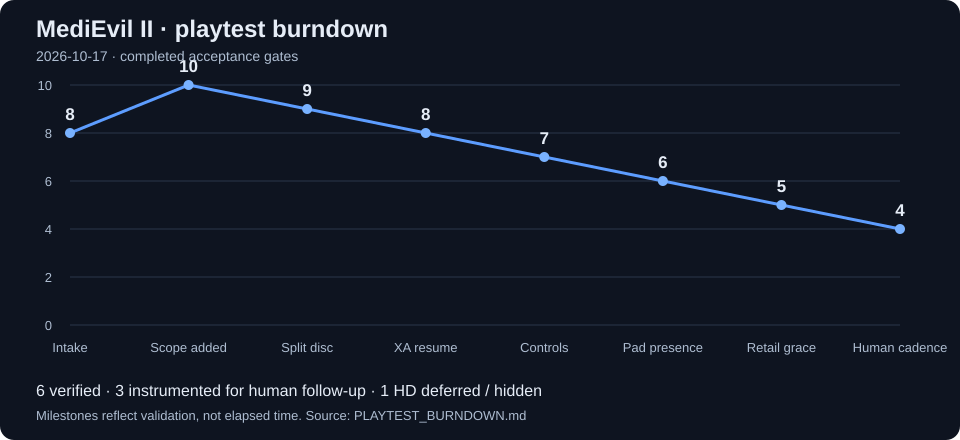

# MediEvil II v0.2.1-alpha playtest burndown

Owner reports received 2026-10-17. Central tracker: `beads-jfkv`, under
`beads-eio.19`. Working branch: `fix/medievil2-playtest-burndown`.

## Burndown chart

Count a report as resolved only after its acceptance gate passes. A code change
or a suspected original-game behavior alone does not close a report.

| Milestone | Reports remaining | Resolved |
| --- | ---: | ---: |
| Intake (2026-10-17) | 8 | 0 |
| Owner additions: modern controls and pad-presence diagnostics | 10 | 0 |
| Split-disc layouts verified | 9 | 1 |
| XA resume verified | 8 | 2 |
| Modern controls verified | 7 | 3 |
| Live pad hotplug replay verified | 6 | 4 |
| Retail damage grace verified | 5 | 5 |

Five of ten items are verified: four fixes/features and one original-behavior
finding. Four remain active; the HD item is deferred by the owner. This is a
milestone chart, not a calendar forecast.

| ID | Priority | Report | Status | Acceptance gate |
| --- | --- | --- | --- | --- |
| M2-01 | P1 | Split-track USA disc rejected by Resident Loading and Adaptive View | Verified | Both exact disc identities accepted; all guarded disc patches match both layouts; exact hash targeting retained. |
| M2-02 | P2 | HD-enabled title and cutscenes run slowly with skipping audio | Deferred by owner pending pack identity | Reproduce HD on/off with identical settings and inputs; measure guest cadence and host work; fix the measured bottleneck and verify replacement rendering. |
| M2-03 | P1 | Pausing the opening ghost dialogue restarts voice ahead of captions | Verified | Controller traces resume forward without a new Setloc; ReadN/S and save/load compatibility checks pass. |
| M2-04 | P1 | General slowdown; evaluate Ape Escape cycle accounting | Investigating | Distinguish host overload from guest frame deadlines; qualify the minimum gameplay-only scale if warranted; preserve menus, movies, audio clock and simulation identity. |
| M2-05 | P2 | Brief stalls interacting with objects | Open | Locate events in the no-HD route; measure/loading-profile them; verify the fix through the same interactions. |
| M2-06 | P2 | Right-stick and L2/R2 camera controls feel clunky; direction limitations | Mapping checked; feel QA open | Native actions retained; optional mouse look, immediate reversal and horizontal/vertical direction options added. Authored camera restrictions still apply. |
| M2-07 | P2 | Some enemy hits appear not to register | Open | Identify attacks/contact events in replay and compare unmodified gameplay; fix any confirmed divergence. |
| M2-08 | P2 | Very rapid damage near enemies; possible missing grace period | Retail grace verified; no balance change | All 29 surviving hits in the live write trace start the original ten-update grace counter. No health loss occurs while it is active. |
| M2-09 | P2 | Add modern mouse and keyboard controls | Verified | Optional package boots; Windows SDL3/Linux SDL2 tests cover WASD, mouse look, Space jump, shortcuts, guards and restoring saved bindings. |
| M2-10 | P1 | Record per-seat controller plugged-in state (`beads-eio.19.18`) | Verified; Beads closed | Live analog/digital P1 unplug/replug and device-profile restoration replay 905 frames with zero divergence; model covers independent P2 hotplug too. |

## Evidence and constraints

- Inputs: `hdSession.7z` and `noHDsession.7z`, supplied by the owner. Private
  extraction: `F:/Projects/psxrecomp/_medievil2-feedback-20261017/`.
- Both sessions identify `0.2.1-alpha+396dd9c0071e`, execution identity
  `a45799857ef4be4851e3bd2957092a1955434f1c8942f65093da26ad875ad1e9`.
- Both use OpenGL, 1080p, supersampling 4, antialiasing, VSync, analog P1,
  and multitap. The settings-file interpolation flag is off, but the default
  Smooth Presentation mod enables interpolation independently. Render/present
  threads are disabled. Saved settings are identical. Their HD selection is an
  external path on the reporter's machine; the pack itself is not in either
  archive. Archives contain inputs, settings and starting cards, not timing logs.
- HD is enabled in one recording and disabled in the other. Default features
  are implicit in the saved mod state. Replay must use private cards/settings.
- Split Track 1 SHA-256 supplied:
  `709558d421e32aeb5a0880762f899ae79938d2396be654b2c819999813848db8`.
  Canonical Track 1 SHA-1 in `catalog_identity.json`:
  `017b855353abd86c22aa516690e852b641e4fa71` (450,885,456 bytes).
- Both affected manifests originally targeted only merged SHA-256
  `dfcb8602274c70f59551e820d0f4026b0213fd68b7d2a385189d37eb767b2d97`.
- Ape Escape `27ed4f0` introduced `guest_cycle_scale = 2`; `dc914c1` restricted
  it to gameplay because menu/introduction cadence accelerated. MediEvil II's
  pinned framework already supports scaling and RAM/plugin gates. No scaling
  change is accepted without a MediEvil II gate and measured validation.
- Unattended tests preserve audio emulation with silent output. Owner-facing
  QA candidates must retain normal audio by default.

## Validation ledger

### Disc layouts

Reconstructed the canonical split layout from the owned merged disc. Track 1
matches both the supplied SHA-256 and catalog SHA-1. All seven guarded
`disc_user` widescreen patches match on both layouts. The target lists retain
exact SHA-256 matching. A real split-disc boot accepts both packages and
prepares 25 resident files / 66 PP20 results / 46,634,340 bytes.

### Dialogue pause/resume

The original controller trace issues Setloc 27:11:10, pauses at 27:16:58, then
issues ReadS without another Setloc. The old implementation unconditionally
rewinds to the old target. After the fix, a live opening-dialogue probe pauses
at 27:14:58 and resumes forward at 27:14:64, retaining the original seek target.
Both ReadN and ReadS, repeated pause/resume, explicit seek/new Setloc, and
save/load of an unconsumed Setloc have controller-level coverage. New CDF3
snapshots retain pending-location state and still read CDF2 and legacy saves.
Shared framework commit: `8bee2b14f2dc54f625e167eeeb6582ba560921a8`.

### Timing and interaction investigation

At the same stationary Museum checkpoint over eight seconds:

| Timing | Guest VBlanks | Simulation updates | Native draws |
| --- | ---: | ---: | ---: |
| Default | 480 | 240 (30/s) | 240 |
| Gameplay-gated cycle scale 2 | 480 | 320 (40/s) | 320 |

The Ape Escape setting accelerates this title even with menu/movie gates. It
is rejected; no cycle-scale change is shipped. The archives contain no host
timings and cannot establish whether the reported stalls are guest deadlines,
loading events or host rendering overload. Interaction stalls remain open.
The combat trace also contains three grace-counter intervals longer than the
usual 20 VBlanks (23, 24 and 26), providing bounded cases to investigate guest
update deadlines. They do not establish the correct retail CPU accounting.
The recorder itself averaged 28.9 microseconds per VBlank over 24,020 rows,
with a 260.3-microsecond maximum and no sample over one millisecond in that run.

### Replay and combat investigation

The reporter's v1 recording fails strict RAM verification at sequence 933 even
on its original release executable. It is not an exact reproduction. A
separately labelled developer input-only run accepts all 61,083 recorded input
boundaries on the corrected build; it does **not** verify RAM or establish that
later interactions match the reporter's original route. The release build
rejects this developer mode.

That exploratory run reaches Museum combat and records thirty 10-point health
losses, ending in death at guest frame 57,019. Several losses are separated by
roughly 20 VBlanks. Retail code checks player actor offset `+0x60` at
`0x80041954`, writes 110 after damage at `0x80041DEC`, and advances it to 120
before clearing at `0x800422B8` (ten gameplay updates).

A second complete 61,083-input exploration captures 388 writes around the
player's health and grace state. All 29 surviving hits write 110, advance to
120, then clear to zero; no further health loss occurs inside those intervals.
Twenty-six last 20 VBlanks, and three last 23–26. The thirtieth hit is fatal.
This run performs zero extra interpolated draws. The short grace period is
present in both the retail instructions and live execution; it is about a
third of a second at the normal 30 updates/s. No balance adjustment is made.
Trace frame numbers use the runtime counter (first hit 55,639, fatal hit
60,167); the earlier polling probe used the game's separate counter.

A separate checkpoint comparison applies 6,030 inputs with interpolation on
and off, including 3,192 extra draws in the on case. The clipped route after
restore does not reach the same contacts, so it is **not** accepted as a combat
comparison. Hit registration remains open. Future reproduction should use a
fresh v2 recording with the exact candidate build and starting mod choices.

### Modern controls and diagnostics

The new optional package uses temporary bindings and native actions; see
[MODERN_CONTROLS.md](MODERN_CONTROLS.md). Tests exercise capture/release,
focus/menu guards, camera reversals, non-consuming mouse samples, decay,
shortcuts and restoration of saved bindings. Windows SDL3 and Linux SDL2 tests
pass. No direct combat or inventory RAM edits are made.

Diagnostics v2 appends independent P1/P2 presence without conflating it with
controller type. The model test unplugs/replugs P1 in analog and digital modes,
hotplugs P2, and verifies 200 frames with no divergence. A real fresh v2 title
recording replays 2,000 frames with no divergence. A second live recording
unplugs/replugs P1 in analog and digital modes while P2 remains absent; all 905
frames, including restoration of the configured device after injection, replay
with zero input/RAM divergence. This passes and closes
`beads-eio.19.18`. The title exposes one player; independent P2 hotplug is
validated in the model, rather than claimed as a two-player title playtest.

Framework input support is committed as `fedb5319d22e33aa9f1bbb3a088e9a453d0b8610`;
the developer serial hotplug injector is `cf9bf1f9fdaf33624822aa09e540fcaa72313881`.
The latter also makes a forced plain digital pad lose DualShock configuration
capability, so the hotplug fixture models the intended controller correctly.
Device-profile restoration after the probe is committed as
`6bc150c85c6086cc3bf5cf0c76335e3ac0f22426`, the framework revision pinned here.

Windows writer, diagnostics, controls, replay preparation and package build
identity checks pass. Packaging rejects an older executable whose embedded
diagnostic build ID differs from the source commit in its manifest. Linux
controller, controller-source, keyboard, mouse policy, modern controls and
diagnostic recording/replay checks also pass. These are bounded checks, not a
full game playthrough. Private ROMs, cards, states and RAM dumps are excluded
from source control.
